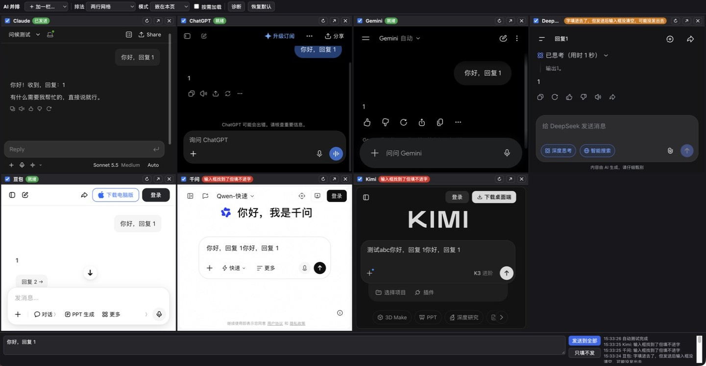
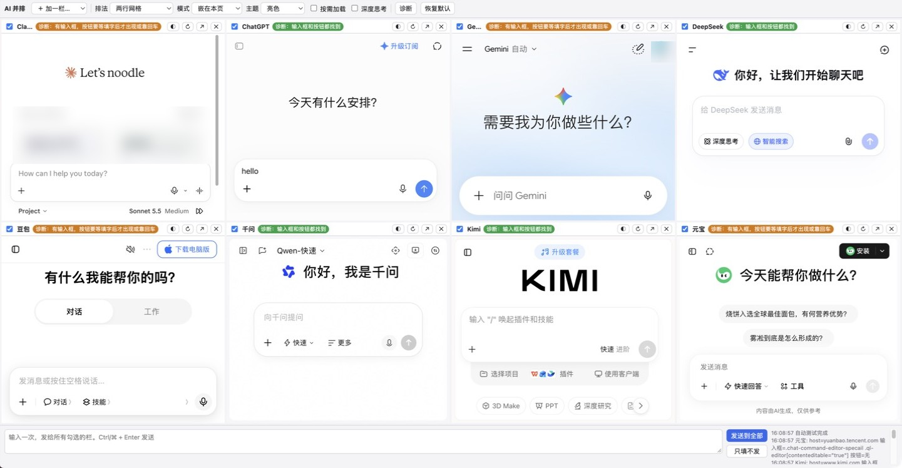
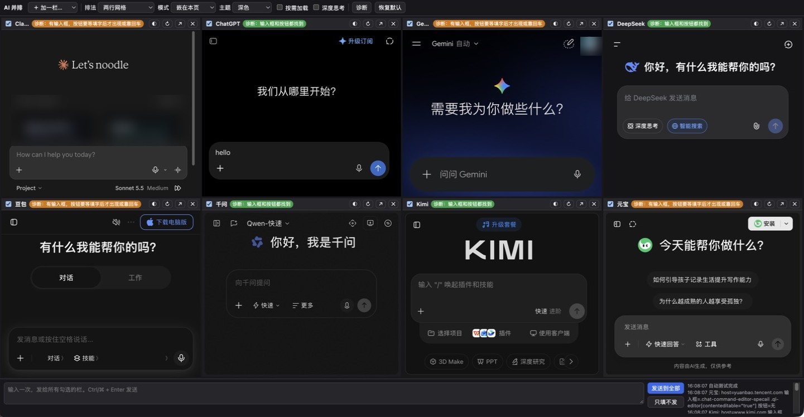
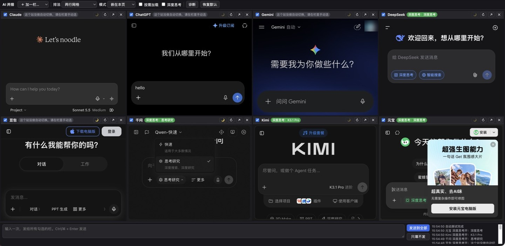

# AI 并排对比（AI Multiview）

一个 Chrome 插件（Manifest V3）：把 Claude、ChatGPT、Gemini、DeepSeek、豆包、千问、Kimi、元宝等多个 AI 网站并排放在**一个页面**里，**输入一次，依次发给所有窗口**，方便对比回答。



## 功能

- **并排显示**：默认 8 个站，两行网格；也可以切成「一排（可拖宽）」或「横向滚动」。可以加栏、删栏、加自定义网址，拖栏头换位置，布局会自动保存。
- **一键广播**：底部输入框写一次，点「发送到全部」或按 ⌘/Ctrl + Enter。每栏头上的勾选框决定发不发这一栏，角标显示结果（已发送 / 没找到输入框 / 可能没发出去）。「只填不发」只填字，不点发送。
- **深度思考开关**：工具栏勾「深度思考」，给支持的站切到推理模式，取消勾选就切回快速模式。
- **亮色 / 深色主题**：工具栏「主题」可以选跟随系统、亮色或深色，插件页面跟着换色。
  - 跟随系统主题的网站会自己切换：插件页面会把当前主题告诉嵌进来的网站。
  - 不跟着变的网站（例如豆包、千问），插件会量它的实际底色，和所选主题不一致就加反色滤镜，图片和视频保持原色。
  - 栏头 ◐ 按钮可以单独设置一栏：◐ 自动 → 🌗 一直反色 → ○ 保持原样。
- **诊断**：逐栏检查找不找得到输入框和发送按钮，站点改版后用来排查。
- **多窗口模式（备选）**：某站嵌不进来时，切到「多窗口平铺」，用真实窗口按屏幕平铺，广播照样能用。
- **用你已有的登录**：插件不碰账号密码。在普通标签页登录过的站，嵌进来后直接就是已登录状态。

| 亮色 | 深色 |
|---|---|
|  |  |



## 安装

1. 下载或 `git clone` 本仓库。
2. Chrome 地址栏打开 `chrome://extensions`，打开右上角的「开发者模式」。
3. 点「加载已解压的扩展程序」，选择本仓库目录；也可以直接把目录拖到这个页面上。
4. 点工具栏上的蓝色图标，打开并排页。建议先在拼图菜单里把它钉住。

改了代码以后，在 `chrome://extensions` 点本插件卡片上的刷新按钮；或者在地址栏打开 `chrome-extension://<扩展ID>/multiview.html#reload`。

## 各站测试结果（2026-11-05，macOS Chrome）

| 站点 | 嵌入显示 | 已有登录 | 广播发送 | 深度思考开关 | 亮色 / 深色 |
|---|---|---|---|---|---|
| Claude | ✅ | ✅ | ✅ | 不支持，请在栏里手动选 | 网站自己切换 |
| ChatGPT | ✅ | ✅ | ✅ | 不支持，请在栏里手动选 | 网站自己切换 |
| Gemini | ✅ | ✅ | ✅ | 不支持，请在栏里手动选 | 网站自己切换 |
| DeepSeek | ✅ | ✅ | ✅ | ✅ 「深度思考」开关 | 网站自己切换 |
| 豆包 | ✅ | 测试时未登录，可以游客聊天 | ✅ | 不支持 | 深色靠插件反色 |
| 千问 | ✅ | ✅ | ✅ | ✅ 「快速 / 思考研究」 | 深色靠插件反色 |
| Kimi | ✅ | 测试时未登录 | ✅ | ✅ 「快速 / K3.1 Pro」 | 网站自己切换 |
| 元宝 | ✅ | 测试时未登录 | ✅ | ✅ 「快速回答 / 深度思考」 | 网站自己切换 |

## 原理

- **嵌入**：并排页打开时，后台用 `declarativeNetRequest` 加一条 session 规则，**只对这一个标签页里的子框架**去掉 `X-Frame-Options` 和 `Content-Security-Policy` 两个响应头。关掉页面时规则就删除，普通标签页不受影响。
- **广播**：`content.js` 注入到各站，只在「父页面是本插件」的子框架里才动作；并排页通过 `postMessage` 下指令，一个站一个站地依次发。同一时间只有一个框能拿到焦点，所以不能并发。
- **填字**：普通文本框（textarea）直接赋值，再触发 input 事件；富文本编辑器（ProseMirror、Quill、Lexical）用 `execCommand('insertText')`；Slate 编辑器（千问）模拟粘贴。填完后，等发送按钮变成可点再点；找不到按钮才按回车。
- **站点配置**都在 `sites.js`：网址、输入框和发送按钮的选择器、深度思考怎么切、是否默认深色。站点改版导致失效时，只需改这个文件。

## 局限

- 各站改版后选择器会失效，需要更新 `sites.js`。欢迎提 PR。
- 不绕过网站自己的防嵌套脚本、人机验证（Cloudflare 等），也不改 UA 或 `Sec-Fetch-*`。碰到这类站请用多窗口模式，或者点 ↗ 在新标签页打开。
- 登录请在普通标签页完成，Google 账号的登录页不能在框里走。
- 同时开 8 个站要占几 GB 内存，可以勾「按需加载」。
- 同时给多个站发消息，可能触发个别站的频率限制。
- 反色是滤镜，个别图标或配色可能不完全自然。看着别扭的栏，把 ◐ 点成 ○ 保持原样。
- 去掉 CSP 会降低这几个嵌入框的防护，影响范围只限插件页这一个标签页。

## 开发用的地址参数

只能在地址栏手动输入，网页没法跳转到扩展页面。

- `multiview.html#reload`：重新加载整个扩展。
- `multiview.html#autotest`：等各栏就绪后自动跑一遍诊断。加 `&theme=light` 或 `&theme=dark` 切换主题，加 `&think=1` 或 `&think=0` 切换深度思考，加 `&send=文字&only=qwen,kimi` 只给指定的栏发送。结果写进 `chrome.storage.local` 的 `aimvTest`。
- `multiview.html#popout&autotest...`：开一个前台窗口跑上面的测试。后台标签页的框不排版，有些站的按钮会找不到。

## 目录

```
manifest.json     权限、注入脚本声明
background.js     打开并排页；按标签页加/删去响应头的规则；多窗口模式
multiview.html/.css/.js   并排页：布局、广播、深度思考、主题、诊断
content.js        注入各站：填字、发送、切换深度思考、量底色并反色
sites.js          各站配置（改版失效只改这里）
icons/  docs/
```

## 许可

MIT
